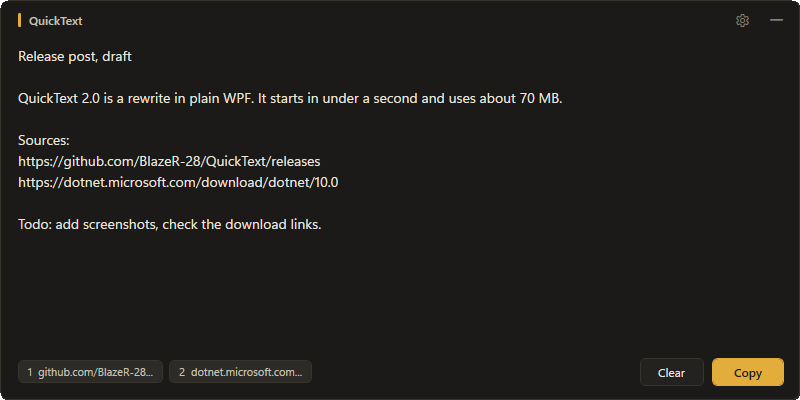
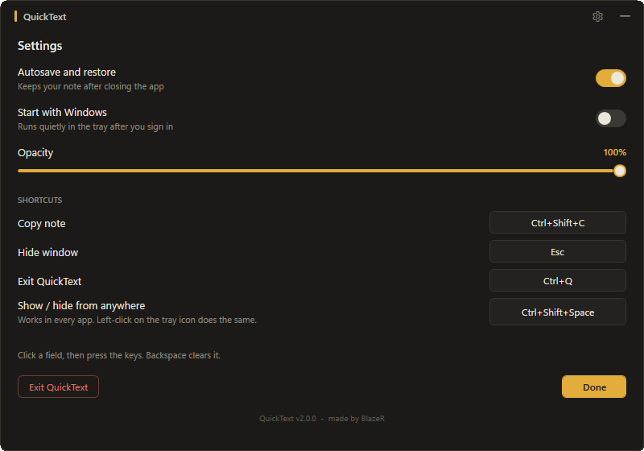

<p align="center"></p>
<h1 align="center">QuickText</h1>
<p align="center">A small scratchpad for Windows. One shortcut opens it, one hides it. Plain text, no account, no network.</p>

<p align="center">
  <a href="https://github.com/BlazeR-28/QuickText/actions/workflows/build.yml"></a>
  <a href="https://github.com/BlazeR-28/QuickText/releases/latest"></a>
  <a href="LICENSE"></a>
  <a href="https://github.com/BlazeR-28/QuickText/releases"></a>
</p>

<p align="center"><a href="#download">Download</a> · <a href="#getting-started">Getting started</a> · <a href="CHANGELOG.md">Changelog</a></p>

<p align="center"></p>

QuickText is made for short, temporary notes: collecting text from several websites, rewriting a paragraph, drafting a prompt. It stays in the background, uses about 70 MB while open and 20 to 30 MB while hidden.

## Features

- **Instant:** a system-wide shortcut shows or hides the window from any app, `Ctrl+Shift+Space` by default.
- **Plain text only:** no tabs, no history, no search. Pasted text arrives without formatting.
- **Safe:** the note is saved as you type and restored on the next start. Clear can be undone with `Ctrl+Z`.
- **Links as pills:** URLs in your note show up at the bottom. Hover highlights the link in the text, a click opens it in your browser.
- **Spell checking** with suggestions in the right-click menu.
- **Yours to adjust:** shortcuts, window opacity, and an optional quiet start with Windows. Size and position are remembered.
- **Private:** no network code, no telemetry. Everything stays in one folder on your machine.

## Download

1. Download **`QuickText.exe`** from the [latest release](https://github.com/BlazeR-28/QuickText/releases/latest).
2. Double-click it. There is nothing to install and no runtime to add.

QuickText needs Windows 10 or 11, 64-bit.

> [!NOTE]
> The file is not code-signed, so Windows may show "Windows protected your PC". Click **More info**, then **Run anyway**. To check that the download is the original, compare its SHA-256 hash with `SHA256SUMS.txt` from the release.

| File | Size | Needs |
| :--- | :--- | :--- |
| `QuickText.exe` | about 125 MB | nothing |
| `QuickText-needs-dotnet.exe` | about 0.3 MB | the [.NET 10 Desktop Runtime](https://dotnet.microsoft.com/download/dotnet/10.0/runtime) |

To remove QuickText, delete the exe and the folder `%LOCALAPPDATA%\QuickText`.

## Getting started

1. Start QuickText. A tray icon appears in the notification area. On Windows 11 new icons first sit under the arrow, drag it out to keep it visible.
2. Type or paste. Press **Copy** when you are done.
3. Press **Esc** or the minus button to hide the window. Press **Ctrl+Shift+Space** or click the tray icon to bring it back.
4. Quit with **Ctrl+Q**, the tray menu, or the settings.

Starting the app a second time just brings the running window to the front.

All shortcuts can be changed in the settings (gear icon): click a field, press the keys, Backspace clears it.

| Action | Default | Works |
| :--- | :--- | :--- |
| Show / hide | `Ctrl+Shift+Space` | in every app |
| Hide window | `Esc` | when the window is focused |
| Copy note | `Ctrl+Shift+C` | when the window is focused |
| Exit | `Ctrl+Q` | when the window is focused |

Combinations that would get in the way of typing are refused, for example a bare letter or `Ctrl+Alt+letter` (AltGr on many keyboard layouts). If another program already owns the system-wide shortcut, the settings say so, and the tray icon still works.

<p align="center"></p>

## Your data

Everything lives in `%LOCALAPPDATA%\QuickText`: `settings.json`, and `notes.txt` while autosave is on.

- `QUICKTEXT_DATA_DIR` moves that folder, for example next to the exe on a USB stick.
- Spell checking follows your Windows display language. `QUICKTEXT_SPELLCHECK_LANGUAGE` (for example `en-US`) sets another one.

## Troubleshooting

- **The window is gone.** Click the tray icon, press the global shortcut, or start `QuickText.exe` again.
- **The old taskbar icon still shows after an update.** Windows caches icons. Restart Explorer or sign out and in.
- **Something crashed.** Details are in `%LOCALAPPDATA%\QuickText\crash.log`. Please attach it to an [issue](https://github.com/BlazeR-28/QuickText/issues/new/choose).

## Build from source

You need the [.NET 10 SDK](https://dotnet.microsoft.com/download/dotnet/10.0).

```powershell
dotnet publish src/QuickText -c Release -o out
```

This creates the self-contained `out/QuickText.exe`. Add `-p:SelfContained=false` for the small variant. Debug builds keep their data in `%LOCALAPPDATA%\QuickText-dev`, so your real notes are never touched. Pushing a tag like `v2.0.0` makes GitHub Actions build both variants and attach them to a release.

QuickText is a plain WPF application without an embedded browser. The global shortcut, tray icon, window opacity and rounded corners use the Win32 and DWM APIs directly.

## Contributing

Bug reports and small, focused pull requests are welcome. QuickText is deliberately small, so features such as tabs or rich text are out of scope. Please read [CONTRIBUTING.md](CONTRIBUTING.md) first. Security problems go through [SECURITY.md](SECURITY.md).

## License

[MIT](LICENSE). Third-party components bundled in the release are listed in [THIRD-PARTY-NOTICES.md](THIRD-PARTY-NOTICES.md).
